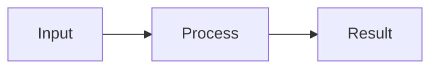

# Small output examples

Emit Markdown directly for display:

| Task | State |
| :--- | :--- |
| Write example | Done |
| Review result | Pending |

- [x] Produce content
- [ ] Confirm appearance

Inline math: $E = mc^2$



For a minimal HTML interaction, use this document as the input to html_preview, then html_render. This is an example, not a claim that interactions were tested:

```html
<!doctype html>
<html lang="en">
<meta charset="utf-8">
<meta name="viewport" content="width=device-width, initial-scale=1">
<style>
body { margin: 0; color: var(--foreground); font-family: var(--font-sans); }
button { font: inherit; color: var(--foreground); background: var(--secondary); border: 1px solid var(--border); border-radius: var(--radius); padding: 8px 12px; cursor: pointer; }
button:focus-visible { outline: 2px solid var(--ring); outline-offset: 2px; }
output { margin-inline-start: 12px; }
</style>
<button type="button" id="add">Add one</button>
<output id="count" aria-live="polite">0</output>
<script>
let count = 0;
document.getElementById('add').addEventListener('click', () => {
  document.getElementById('count').textContent = String(++count);
});
</script>
</html>
```
